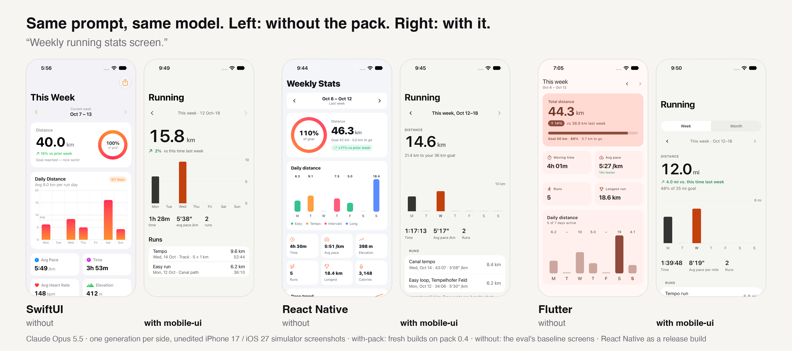

# Mobile UI — a skill pack for agents that build app screens

[](https://github.com/david-g-3654/mobile-ui-skill-pack/actions/workflows/ci.yml)

<sub>Agent Skills format · installs into Claude Code, Codex, Cursor, GitHub Copilot, Gemini CLI, OpenCode, Windsurf and more · SwiftUI, React Native, Flutter (preview)</sub>

> **Platform status (0.4.1).** **SwiftUI and React Native are tested and strong. Flutter is a preview:** it works and scores higher on average than the baseline under all three judges, but it has known large-text and dark-mode issues (content clipped under pinned footers at the largest text size, low-contrast secondary buttons in dark mode). One judge doesn't find the Flutter win significant. Details are in the [Flutter 0.4 results](evals/results/2026-10-15-flutter-v0.4/README.md).

Agents write React Native, SwiftUI and Flutter screens that *work* but look generic: card soup, a 2×2 grid of icon tiles, default blue, six font sizes, a hand-drawn back button, "John Doe". This pack gives them an opinionated design system, a way to classify screens, a component reference for each platform, and a lint for the generic tells. With it, they build screens that look like a designer worked on them.

It's modeled on [diagram-design](https://github.com/cathrynlavery/diagram-design): a philosophy ("the highest-quality move is usually deletion"), a token gate before the first output, per-type references, a complexity budget, and a pre-output taste gate.



<sub>One prompt, one model (Claude Opus 5.5), one generation per side, unedited simulator screenshots, React Native as a release build. The with-pack screens are fresh builds on pack 0.4 ([sources](docs/gallery/sources/)), made for this image and **not** part of the judged eval. The without-pack screens are the eval's own baselines. With dark mode and the largest text size: [SwiftUI](docs/gallery/swiftui-stats.png) · [React Native](docs/gallery/react-native-stats.png) · [Flutter](docs/gallery/flutter-stats.png). The judged screens, all 8 prompts side by side, so you can check this prompt isn't cherry-picked: [SwiftUI](docs/gallery/swiftui-all.png) · [React Native](docs/gallery/react-native-all.png) · [Flutter](docs/gallery/flutter-all.png).</sub>

**The version you install, judged blind by models from three labs.** In a pre-registered run on **pack 0.4** (8 prompts × 2 A/B orderings per platform, judged from screenshots, committed in advance to be published whatever it showed), the with-pack screen was preferred in:

| | SwiftUI | React Native | Flutter |
|---|---|---|---|
| Claude Opus 5.5 | 16/16 | 14/16 | 15/16 |
| GPT-6.1 Sol | 16/16 | 14/16 | 14/16 |
| Grok 4.7 | 15/16 | 14/16 | **11/16** (not significant) |

- **React Native** lost one prompt under every judge. The pack-built transactions screen crashes at launch, because it calls `Intl.NumberFormat.formatToParts`, which Hermes doesn't implement. The pack's money rule led agents there. **0.4.1 fixes it** with Hermes-safe guidance and lint rule MU118, and changes nothing else. Regenerated on 0.4.1, the same prompt went to the pack in 6 of 6 judgments across all three judges ([follow-up](evals/results/2026-10-15-react-native-v0.4.1-list/README.md); one prompt, not a new eval).
- **Flutter is the weak spot.** Grok prefers the Material baseline on auth and splits three other prompts, mostly over large-text clipping and dark mode.
- **Overall:** a two-of-three majority gives the pack 44 of 48 judgments, and every judge scores the pack higher on average on every platform. No human designers have rated yet. [How it was measured, and what it can't tell you →](evals/METHOD.md)

The pack's own templates: [SwiftUI](docs/previews/overview.png) · [React Native](docs/previews/overview-react-native.png) · [Flutter](docs/previews/overview-flutter.png) on iOS, and [React Native and Flutter on Android](docs/previews/overview-android.png).

## What's inside

```
skills/
  mobile-ui/                  core: WHAT the screen is, HOW it should look
    SKILL.md                  philosophy, token gate, archetype router,
                              anti-patterns, budget, taste gate
    references/
      style-guide.md          "Quiet" skin: color roles, type ramp, spacing
      onboarding.md           map a brand / existing tokens onto the roles
      components.md           24 components: anatomy, spec, states, rules
      anti-patterns.md        46 generic tells → fixes (10 found in evals)
      layout-budget.md        frames, rhythm, heights, per-archetype budgets
      copy.md                 sample data, money, labels, empty states
      motion-and-feedback.md  haptics, transitions, toasts
      accessibility.md        contrast, Dynamic Type, touch targets
      lint.md                 what each lint rule catches
      screen-*.md             14 archetypes: home, list, detail, settings,
                              onboarding, paywall, auth, profile, stats,
                              form, chat, search, sheet, states
    scripts/mobile_ui_lint.py 22 rules for generic-UI tells (.swift/.tsx/.dart)
  mobile-ui-swiftui/          HOW in SwiftUI (iOS 17+, Swift 6)
    SKILL.md, references/components.md
    assets/                   DesignSystem.swift, Components.swift, templates/
  mobile-ui-react-native/     HOW in React Native / Expo (Expo Router)
    SKILL.md, references/components.md
    assets/                   theme.ts, components.tsx, templates/
  mobile-ui-flutter/          HOW in Flutter (3.35+, Material 3, adaptive)
    SKILL.md, references/components.md
    assets/                   theme.dart, components.dart, templates/
scripts/
  mobile_ui_lint.py           shim → skills/mobile-ui/scripts/mobile_ui_lint.py
  migrate_to_0_4.py           rename your code to 0.4's Q-prefixed API
  ios_preview.sh              SwiftUI templates on the simulator, screenshots
  rn_preview.sh               RN templates in Expo Go on the simulator
  android_preview.sh          RN / Flutter templates on an Android emulator
  gallery.py                  build the before/after gallery images
  tests/                      lint tests + "typical agent output" fixtures
evals/                        method, every prompt, rubric, scores, results
docs/gallery/                 before/after images (hero, per platform)
docs/previews/                rendered template screenshots
```

## How an agent uses it

1. **Token gate.** Find the project's tokens, or ask once (brand / default skin / "feel like app X"), then copy the platform token file.
2. **Classify.** Map the request to one of 14 archetypes and load that reference. State the one job, the focal element, the primary action, and what's being cut.
3. **Build natively** from the platform skill. Use system navigation, lists, sheets and controls styled with tokens, plus the pack's components where the platform has no equivalent (hero metric, plan card, bottom action bar…).
4. **Gate.** Run `scripts/mobile_ui_lint.py`, then the taste gate: the remove test, hierarchy, native fit, dark mode, large text, accessibility and content.

## The opinions, in one breath

One job, one focal element and one primary action per screen. The primary button is ink, not blue. The accent appears on two elements or fewer. Use four text styles plus a hero, and two weights. Units are smaller than their numbers. Group with canvas and surface plus space, not shadows. Cards are for objects only. Keep rows homogeneous, with chevrons only when a row navigates. Pin the CTA above the home indicator. Design dark mode rather than inverting it. Use realistic sample data. Platform navigation always.

## Install

The skills follow the open [Agent Skills](https://agentskills.io/specification) format, so one repo installs into Claude Code, Codex, Cursor, GitHub Copilot, Gemini CLI, OpenCode, Windsurf and the other agents supported by [`npx skills`](https://github.com/vercel-labs/skills).

**Any agent** (installs all four skills):

```bash
npx skills add david-g-3654/mobile-ui-skill-pack --skill '*'
```

Install all four together. The platform skills read the core `mobile-ui` skill from the sibling directory, and the linter ships inside it (`mobile-ui/scripts/mobile_ui_lint.py`, Python 3 standard library only). To target specific agents, add `-a codex -a cursor`; to install for your user instead of the project, add `-g`.

**Claude Code plugin:**

```bash
claude plugin marketplace add david-g-3654/mobile-ui-skill-pack
```

```bash
claude plugin install mobile-ui@mobile-ui
```

**From a local checkout** (editable, any agent):

```bash
npx skills add ./mobile-ui-skill-pack --skill '*'
```

Tested with `skills` 1.7.2: discovery lists all four skills, and an install for Codex and Cursor puts them in `.agents/skills/`, where the bundled linter runs from a platform skill.

## Verification status (v0.4.1)

| Check | Result |
|---|---|
| SwiftUI assets and templates: `swiftc -typecheck`, iOS 17 simulator SDK, Swift 6 language mode | ✅ passes (re-run on 0.4.1) |
| React Native assets and templates: `tsc --strict` against RN 0.76, Expo Router 4, expo-haptics, vector-icons types | ✅ passes (re-run on 0.4.1) |
| Flutter assets and templates: `flutter analyze` (Flutter 3.47.7) | ✅ no issues (re-run on 0.4.1) |
| SwiftUI templates run on an iPhone 17 / iOS 27 simulator: light, dark, loading, accessibility-XL text | ✅ `scripts/ios_preview.sh`, see `docs/previews/ios-*` |
| Flutter templates rendered (light/dark/loading) via golden tests | ✅ see `docs/previews/flutter-*` |
| Lint and API tests: shipped assets clean, generic fixtures trigger the expected rules, every public symbol `Q`-prefixed, MU118 catches the Hermes crash | ✅ 17/17 tests (re-run on 0.4.1) |
| React Native templates run on an iPhone 17 / iOS 27 simulator (Expo SDK 57, RN 0.86): light, dark, accessibility-XL | ✅ quick check in Expo Go with `scripts/rn_preview.sh`; published previews (`docs/previews/rn-*`) are from a release build (`evals/harness/react-native-release/`) |
| React Native assets also typecheck against SDK 52-era types (RN 0.76) | ✅ |
| Android: React Native (release build) and Flutter templates on a Pixel 8 emulator (Android 15), light, dark, font scale 2.0 | ✅ `scripts/android_preview.sh`, see [overview](docs/previews/overview-android.png) and `docs/previews/android/`. Found and fixed: React Native's off switch was nearly invisible on Android |
| Before/after eval on **0.4** (pre-registered), 8 prompts × 2 orderings, Claude Opus 5.5 | ✅ SwiftUI **16/16** (4.10 vs 2.95) · Flutter **15/16** (4.11 vs 3.17, auth split) · React Native **14/16** (3.67 vs 3.15; lost list: the pack screen crashes at launch). [Results](evals/results/README.md) |
| Earlier evals (0.1–0.3), kept in the record | ✅ SwiftUI 16/16 on 0.1 and 0.2 · React Native 16/16 on 0.2+ · Flutter 14/16 on 0.2+, 15/16 on 0.3 |
| Agent Skills install (`npx skills` 1.7.2): discovery and install for Codex and Cursor | ✅ all 4 skills; bundled linter runs from the installed copy |
| Human raters | ⏳ blind rating page ready, no ratings yet |
| Cross-family judges (non-Claude) | ✅ 0.4: GPT-6.1 Sol 44/48, Grok 4.7 40/48 (Flutter 11/16, not significant); all three agree on 43/48. Earlier runs: GPT-6.1 Sol: 75/80 for the pack, 78/80 agreement with Claude. Grok 4.7: 71/80, 74/80 agreement; Flutter 0.3 not significant under Grok ([GPT](evals/results/cross-family-gpt-6.1-sol/README.md), [Grok](evals/results/cross-family-grok-4.7/README.md)) |
| Android rendering in the judged evals | ⏳ not yet (judged screens are rendered on iOS) |

Run the checks yourself:

```bash
python3 -m unittest discover -s scripts/tests
```

```bash
python3 scripts/mobile_ui_lint.py skills/
```

```bash
scripts/ios_preview.sh docs/previews-local
```

## Research basis

The archetype references and the anti-pattern list come from reviewing ~170 shipped iOS screens across 14 screen types on [Refero](https://refero.design/ios-apps) (settings, home, onboarding, paywall, profile, detail, empty, checkout, search, chat, finance, auth, sheets, stats), together with Apple's Human Interface Guidelines and Material 3. No third-party screenshots are redistributed in this repo.

## License

MIT
